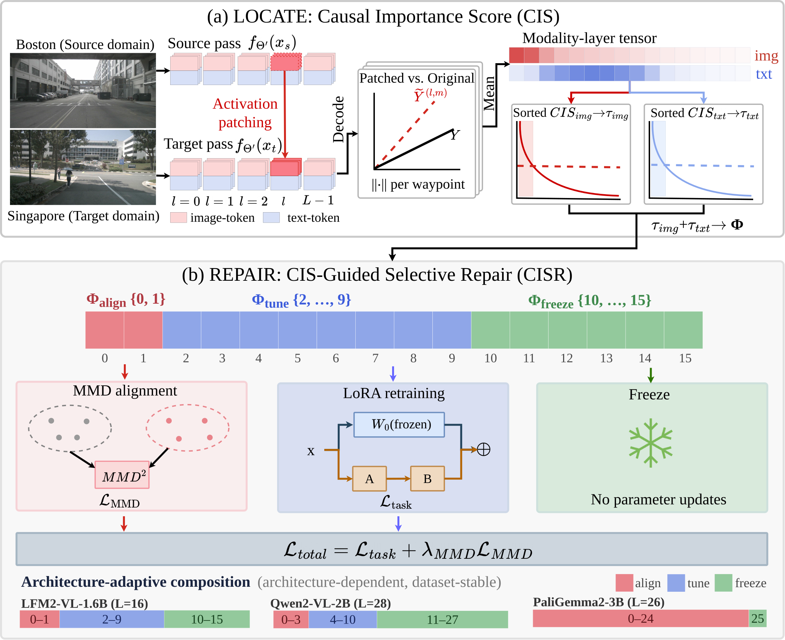

# MoLaRx — Modality–Layer Repair for VLM Trajectory Planning

Code for the paper **"Locating and Repairing Domain Shift in VLM Trajectory Planning"** (NeurIPS 2026).

MoLaRx is a **locate-then-repair** framework that adapts Vision-Language-Model (VLM) trajectory planners to new cities. Instead of treating cross-city domain shift as a single global scalar, MoLaRx exposes its **modality × layer** structure and repairs each zone with a matched operator.

---

## MoLaRx

A VLM planner trained in Boston degrades by **+653%** (0.15 m → 1.13 m trajectory error) when deployed in Singapore. We show that this shift is **not** a global scalar — it is structured along two axes:

1. **Modality axis** — image-token shift and text-token shift peak at different layers.
2. **Layer axis** — every VLM has an architecture-dependent three-zone (or two-zone) layer partition, **stable across datasets**.

MoLaRx **locates** these zones with the **Causal Importance Score (CIS)** and **repairs** each one with a matched operator (**MMD** / **LoRA** / **freeze**). On three architecturally distinct VLMs × two cross-city benchmarks, MoLaRx attains the lowest cross-city gap among adaptation methods in all six main-table settings while training **50–60% fewer trainable parameters** than Full LoRA and running **8.4–10.9 ms faster** at inference.

---

## Framework



*MoLaRx overview. CIS locates cross-city shift by modality and layer; CISR applies matched repair operators to the diagnosed zones.*

### Algorithm

```text
Algorithm 1 — MoLaRx: CIS-guided locate-then-repair
Input : source-trained planner f_Θ′ ; labeled source set S_s ; unlabeled target set S_t
Output: adapted planner f_{Θ′+Δ}

Phase 1 — LOCATE (CIS diagnosis; run once per architecture, reused across datasets)
 1:  P ← N=100 scene-matched pairs (x_s, x_t), nearest neighbours under k(·)          (Eq. 3)
 2:  for m ∈ {img, txt}, ℓ ∈ {0, …, L−1} do
 3:      Ψ̂[m,ℓ] ← mean over P of per-waypoint ‖ f_Θ′(do(H_(ℓ,m)(x_t) ← H_(ℓ,m)(x_s))) − f_Θ′(x_t) ‖₂
 4:  τ_img, τ_txt ← elbows of the sorted per-modality CIS curves                       (Eqs. 5, 9–10)
 5:  Φ_align ← {ℓ : Ψ̂[img,ℓ] > τ_img};  Φ_tune ← {ℓ : Ψ̂[txt,ℓ] > τ_txt} \ Φ_align;  Φ_freeze ← rest   (Eqs. 11–13)

Phase 2 — REPAIR (CISR; no target labels anywhere)
 6:  attach rank-r LoRA: attention-only (Q,K,V,O) on Φ_align; all linear projections on Φ_tune; Δℓ = 0 on Φ_freeze
 7:  for minibatches B_s ⊂ S_s (labeled), B_t ⊂ S_t (unlabeled) do
 8:      ℒ_total ← ℒ_task(B_s; Φ_tune) + λ_MMD · ℒ_MMD(B_s, B_t; Φ_align)              (Eq. 16)
 9:      update Δ only — gradients are routed strictly by zone
10:  return f_{Θ′+Δ}
```


---

## Method

MoLaRx has two modules:

### 1. CIS — Causal Importance Score (locate)

For each `(modality m, layer l)` slice of the hidden state, CIS estimates the per-(modality, layer) causal contribution to the cross-domain trajectory gap via **activation patching** on scene-matched source/target pairs:

> Replace the modality-`m` token block at layer `l` of the *target* forward pass with the corresponding block from a scene-matched *source* sample, then measure the change in predicted trajectory.

Averaged over `N=100` pairs, this produces an empirical tensor `Ψ̂ ∈ ℝ^(2×L)`. Thresholding via the elbow point partitions the `L` decoder layers into three zones:

- `Φ_align` — image-shift-dominant layers (early)
- `Φ_tune`  — text-shift-dominant layers (middle)
- `Φ_freeze` — domain-invariant layers (rest)

### 2. CISR — CIS-Guided Selective Repair (repair)

Each zone gets a matched operator, all trained jointly:

| Zone | Operator | Loss term |
|---|---|---|
| `Φ_align` | Multi-scale MMD on image-token mean-pooled reps | `λ_MMD · L_MMD(B_s, B_t)` |
| `Φ_tune` | Rank-16 LoRA adapters (α=32) | `L_task` (supervised trajectory loss on source) |
| `Φ_freeze` | Frozen, gradients zero-masked | — |

The **operator composition is determined by the discovered partition** and adapts automatically per architecture. Under prefix-LM attention (PaliGemma2), `Φ_tune` collapses to ∅ and Eq. 15 degenerates to MMD-on-`Φ_align` + freeze.

### Per-architecture partitions (discovered by CIS)

| VLM | Layers | Decoder | `Φ_align` | `Φ_tune` | `Φ_freeze` | Trainable |
|---|---|---|---|---|---|---|
| LFM2-VL-1.6B | 16 | causal | {0, 1} | {2…9} | {10…15} | 3.8 M (0.24%) |
| Qwen2-VL-2B | 28 | causal | {0…3} | {4…10} | {11…27} | 4.1 M (0.21%) |
| PaliGemma2-3B | 26 | prefix-LM | {0…24} | ∅ | {25} | — |

---

## Repository structure

```
MoLaRx/
├── supplementary_experiments/  # Supplementary experiments, paper App. C.4–C.6 (see its README.md)
│   ├── kitscenes_longtail/     #   Zero-shot long-tail probe + MMS-inspired closest-mode metric
│   │   ├── kitscenes_probe.py
│   │   └── kitscenes_mms.py
│   ├── planning_proxies/       #   Lateral-error@3s + predicted-jerk proxies on the cross-city splits
│   │   └── planning_proxies.py
│   ├── reverse_direction/      #   Reverse-transfer chains: nuScenes SG→BS + AV2 MIA→PIT (incl. PaliGemma2 CIS run)
│   │   ├── rev_chain_lfm2.sh
│   │   ├── av2_rev_chain.sh
│   │   ├── av2_rev_eval.py
│   │   └── *.sbatch
│   └── inductive_protocol/     #   Transductive-vs-inductive protocol control (same seed)
│       ├── ind_chain.sh
│       └── sameseed_trans_eval.sh
├── lfm2_vl_pipeline/           # LFM2-VL-1.6B (16-layer, LTC-hybrid, causal)
│   ├── config_vl.py
│   ├── phase0_vl_finetune.py            # Phase 0: source-domain LoRA fine-tune
│   ├── phase1_vl_domain_probing.py      # Phase 1: CIS / DPA diagnostics
│   ├── phase1_vl_counterfactual.py      # Phase 1: text-token activation patching
│   ├── phase1_vl_image_counterfactual.py# Phase 1: image-token activation patching
│   ├── phase1_vl_probing/               # Per-layer probing variants
│   ├── phase2_vl_finetune.py            # Phase 2: CISR (MMD + selective LoRA)
│   ├── phase2_vl_finetune_vg2.py        # Phase 2 on Visual-Grounding-v2 split
│   ├── phase2_vg2_evaluate.py           # Phase 2 evaluation (VG2)
│   ├── phase0_vl_evaluate.py            # Phase 0 evaluation
│   ├── phase0_vl_evaluate_traj.py       # Phase 0 trajectory eval
│   ├── bootstrap_cis_partition.py       # Bootstrap stability of CIS partition
│   ├── visual_grounding_finetune.py     # Visual-grounding pre-task
│   ├── visual_grounding_v2_finetune.py  # Visual-grounding v2 pre-task
│   ├── visual_grounding_evaluate.py     # VG evaluation
│   ├── image_ablation_eval.py           # Image-input ablation eval
│   ├── temporal_frames_eval.py          # Temporal-frame ablation eval
│   ├── prepare_vl_data.py               # nuScenes/AV2 → JSONL conversion
│   ├── merge_lora.py                    # Merge LoRA weights into base
│   ├── utils/                           # MMD loss, helpers
│   └── training_configs/                # Per-checkpoint LoRA/tokenizer configs
│
├── qwen_vl_pipeline/           # Qwen2-VL-2B (28-layer, pure Transformer, causal)
│   ├── config_qwen.py
│   ├── phase0_qwen_finetune.py
│   ├── phase1_qwen_probing.py
│   ├── phase2_cisr_qwen.py
│   ├── phase2_qwen_eval.py
│   ├── visual_grounding_qwen_*.py
│   └── training_configs/                # Per-checkpoint LoRA/tokenizer configs
│
├── paligemma_vl_pipeline/      # PaliGemma2-3B (26-layer, prefix-LM, bidirectional images)
│   ├── config_paligemma.py
│   ├── paligemma_common.py
│   ├── phase0_paligemma_tvg.py
│   ├── phase1_cis_paligemma.py          # Phase 1: CIS / activation-patching probing
│   ├── phase2_cisr_paligemma.py
│   ├── phase2_paligemma_eval.py         # Phase 2 evaluation
│   └── training_configs/                # Per-checkpoint LoRA/tokenizer configs
│
├── argoverse2_pipeline/        # Shared Argoverse-2 dataset infrastructure
│   └── training_configs/                # AV2 checkpoint configs (LFM2-on-AV2 runs)
│
├── eval_results/               # Evaluation outputs
│   ├── lfm2_av2_eval.json
│   ├── lfm2_nus_eval.json
│   ├── paligemma_av2_eval.json
│   ├── paligemma_nus_eval.json
│   ├── qwen_av2_eval.json
│   └── qwen_nus_eval.json
│
├── README.md
├── LICENSE
└── .gitignore
```

**Note on `argoverse2_pipeline/`.** This is a shared Argoverse-2 dataset
infrastructure; its `outputs/data/` is consumed by all three VL pipelines for
AV2 cross-city evaluation.

**Note on `training_configs/`**: Each pipeline includes a `training_configs/`
folder that stores `adapter_config.json`, `tokenizer_config.json`,
`processor_config.json`, etc. for every checkpoint used in the paper,
documenting the exact LoRA hyperparameters (rank, alpha, target modules) and
processor settings. Model weights themselves are excluded due to size.

Each pipeline follows the same three phases:

- **Phase 0** — LoRA fine-tune the VLM as a trajectory planner on the **source** city (Boston / Pittsburgh).
- **Phase 1** — Compute the modality–layer CIS tensor via activation patching on scene-matched pairs; derive the zone partition `(Φ_align, Φ_tune, Φ_freeze)`.
- **Phase 2** — CISR: train MMD on `Φ_align` + LoRA on `Φ_tune` + freeze `Φ_freeze`, then evaluate.

---

## Installation

### 1. Environment

Tested on Ubuntu 22.04 / Python 3.10 / CUDA 12.1, single A100-80G or RTX 6000 Ada.

```bash
# (Recommended) create a fresh env
conda create -n molarx python=3.10 -y
conda activate molarx
```

### 2. Python packages

PyTorch — install the CUDA build that matches your driver:

```bash
# CUDA 12.1 example; see https://pytorch.org for other versions
pip install torch==2.4.0 torchvision --index-url https://download.pytorch.org/whl/cu121
```

VLM stack:

```bash
pip install transformers>=4.45 peft>=0.12 trl>=0.11 accelerate>=0.34 safetensors
```

Dataset toolkits:

```bash
pip install nuscenes-devkit         # nuScenes
pip install av2                     # Argoverse 2 Sensor
pip install pyquaternion            # ego-pose math (used by both)
```

Numerics & utilities:

```bash
pip install numpy scipy scikit-learn pillow tqdm matplotlib
```

> PaliGemma2 is gated on Hugging Face. Run `huggingface-cli login` once and accept the model license at <https://huggingface.co/google/paligemma2-3b-mix-224> before using `paligemma_vl_pipeline/`.

### 3. Pre-trained VLM weights

The three backbones are downloaded automatically on first use (cached under `~/.cache/huggingface/`):

| Pipeline | Hugging Face model ID | Approx. size |
|---|---|---|
| `lfm2_vl_pipeline/`     | [`LiquidAI/LFM2-VL-1.6B`](https://huggingface.co/LiquidAI/LFM2-VL-1.6B)             | ~3.2 GB |
| `qwen_vl_pipeline/`     | [`Qwen/Qwen2-VL-2B-Instruct`](https://huggingface.co/Qwen/Qwen2-VL-2B-Instruct)     | ~4.4 GB |
| `paligemma_vl_pipeline/`| [`google/paligemma2-3b-mix-224`](https://huggingface.co/google/paligemma2-3b-mix-224) | ~5.9 GB |

To pre-fetch them (e.g. on a node with internet before moving to a compute node):

```bash
huggingface-cli download LiquidAI/LFM2-VL-1.6B
huggingface-cli download Qwen/Qwen2-VL-2B-Instruct
huggingface-cli download google/paligemma2-3b-mix-224
```

---

## Data preparation

The three pipelines share the same processed JSONL splits — only the prompt template changes per backbone. Expected layout from the repo root:

```
data/nuscenes/                            # raw nuScenes (you provide)
lfm2_vl_pipeline/outputs/data/            # processed nuScenes splits
└── {train,val,test_id,test_ood}.jsonl
argoverse2_pipeline/outputs/data/         # processed AV2 splits
└── {train,val,test_id,test_ood}.jsonl
```

### nuScenes — Boston-Seaport → Singapore

1. Register and download **nuScenes v1.0-trainval** from <https://www.nuscenes.org/nuscenes>. You need:
   - `v1.0-trainval_meta.tgz` (metadata)
   - `v1.0-trainval0X_blobs.tgz` (sensor blobs — only `samples/CAM_FRONT/` is used)

2. Extract under `data/nuscenes/` at the repo root (or set a different absolute path — see step 3):
   ```
   data/nuscenes/
   ├── maps/
   ├── samples/CAM_FRONT/...
   ├── sweeps/
   └── v1.0-trainval/
   ```

3. The default in `lfm2_vl_pipeline/config_vl.py` is:
   ```python
   NUSCENES_DATAROOT = "data/nuscenes"
   NUSCENES_VERSION  = "v1.0-trainval"
   ```
   Edit `NUSCENES_DATAROOT` if your dataset lives elsewhere.

4. Build the JSONL splits:
   ```bash
   python lfm2_vl_pipeline/prepare_vl_data.py
   ```

   Produces under `lfm2_vl_pipeline/outputs/data/`:
   - `~26.6k` train samples (Boston-Seaport)
   - `3,569` ID-test (Boston-Seaport)
   - `3,500` OOD-test (Singapore)

   The Qwen and PaliGemma pipelines read the same JSONL files — no separate prep needed.

### Argoverse 2 Sensor — Pittsburgh → Miami

> **Note.** Phase-0/1/2 scripts read pre-built splits from `argoverse2_pipeline/outputs/data/{train,val,test_id,test_ood}.jsonl`. The AV2 prep script itself is **not** included in this release; the splits must be built externally following Appendix A.1 of the paper. A reference prep script will be added in a future commit.

Until then:

1. Install the AV2 dataloader and download the **Sensor** dataset (val split) following <https://www.argoverse.org/av2.html#download-link>:
   ```bash
   pip install av2
   ```
2. Process the 57 validation logs into the same JSONL schema used by nuScenes (one record per keyframe with `image_path`, `history_trajectory`, `future_trajectory`, `city ∈ {PIT, MIA}`).
3. Place the resulting files under `argoverse2_pipeline/outputs/data/`. Target counts: `858 train / 284 ID-test / 1,393 OOD-test`.

### Disk footprint

| Item | Approx. size |
|---|---|
| nuScenes raw (`samples/CAM_FRONT/` only) | ~150 GB |
| Argoverse 2 Sensor (val logs only) | ~80 GB |
| Processed JSONL + cached frames | ~40 GB |
| One full set of checkpoints (3 VLMs × 2 cities × phases) | ~30 GB |

---

## Usage

Replace `lfm2_vl_pipeline` with `qwen_vl_pipeline` or `paligemma_vl_pipeline` to run on other backbones.

### Phase 0 — source-domain fine-tune

```bash
CUDA_VISIBLE_DEVICES=0 python lfm2_vl_pipeline/phase0_vl_finetune.py
```

### Phase 1 — CIS diagnosis

```bash
# Image-token causal patching
python lfm2_vl_pipeline/phase1_vl_image_counterfactual.py --max_pairs 100

# Text-token causal patching
python lfm2_vl_pipeline/phase1_vl_counterfactual.py --max_pairs 100

# Combined CIS + DPA atlas
python lfm2_vl_pipeline/phase1_vl_domain_probing.py
```

This writes the per-layer `(CIS_img, CIS_txt)` tensor and the elbow-derived partition `(Φ_align, Φ_tune, Φ_freeze)`.

### Phase 2 — CISR (selective repair)

```bash
# Main strategy
python lfm2_vl_pipeline/phase2_vl_finetune.py --strategy cis_selective_lora

# Run all ablations
python lfm2_vl_pipeline/phase2_vl_finetune.py --strategy all
```

Available strategies (also covered in the ablation table):

| Strategy | Description |
|---|---|
| `cis_selective_lora` | **Main**: LoRA on `Φ_tune` + MMD on `Φ_align` + freeze `Φ_freeze` |
| `full_lora_da` | LoRA on all layers + uniform MMD (no CIS) |
| `random_selective_lora` | LoRA on random layers + MMD (CIS vs. random control) |
| `full_lora_no_da` | LoRA on all layers, no MMD |
| `txt_da_no_lora` | MMD only, no LoRA |

### Cross-dataset partition transfer

The CIS partition is **architecture-dependent and dataset-stable**, so a partition diagnosed on one dataset transfers zero-shot to another (Table 3 in the paper). To reuse a nuScenes-derived partition on AV2, point Phase 2 to the same `Φ_align`/`Φ_tune` indices — no re-diagnosis needed.

---

## Key results

`∆ADE` is the cross-city gap `ADE(target) − ADE(source)`. Lower is better on all metrics. **MoLaRx attains the lowest gap among adaptation methods in all six settings.**

### nuScenes (Boston-Seaport → Singapore)

| VLM | Source-only ADE | Best baseline ADE | **MoLaRx ADE** | **MoLaRx ∆ADE** |
|---|---|---|---|---|
| LFM2-VL-1.6B  | 4.510 | 4.266 | **4.251** | **3.150** |
| Qwen2-VL-2B   | 5.020 | 4.700 | **4.634** | **2.906** |
| PaliGemma2-3B | 4.450 | 4.320 | **4.190** | **2.337** |

### Argoverse 2 (Pittsburgh → Miami)

| VLM | Source-only ADE | Best baseline ADE | **MoLaRx ADE** | **MoLaRx ∆ADE** |
|---|---|---|---|---|
| LFM2-VL-1.6B  | 5.120 | 4.485 | **4.420** | **1.880** |
| Qwen2-VL-2B   | 4.953 | 5.045 | **4.983** | **1.249** |
| PaliGemma2-3B | 4.715 | 4.560 | **4.507** | **2.112** |

MoLaRx also achieves the **lowest inference latency** (47.4–62.1 ms/sample, 8.4–10.9 ms faster than the best LoRA baseline).

---

## Citation

```bibtex
@inproceedings{cui2026molarx,
  title     = {Locating and Repairing Domain Shift in {VLM} Trajectory Planning},
  author    = {Cui, Zhihong and Liu, Hengyu and Riegler, Michael Alexander and Xu, Guandong and Taherkordi, Amir and Skeie, Tor},
  booktitle = {Advances in Neural Information Processing Systems (NeurIPS)},
  year      = {2026}
}
```

---

## License

MIT License. See [`LICENSE`](LICENSE).
